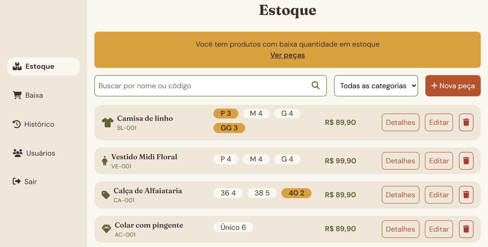
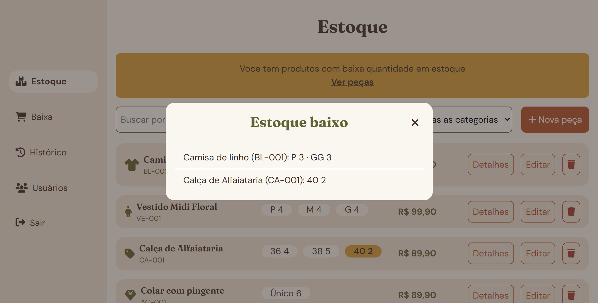
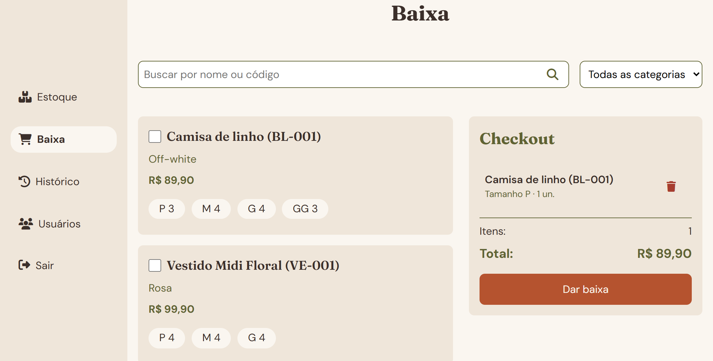
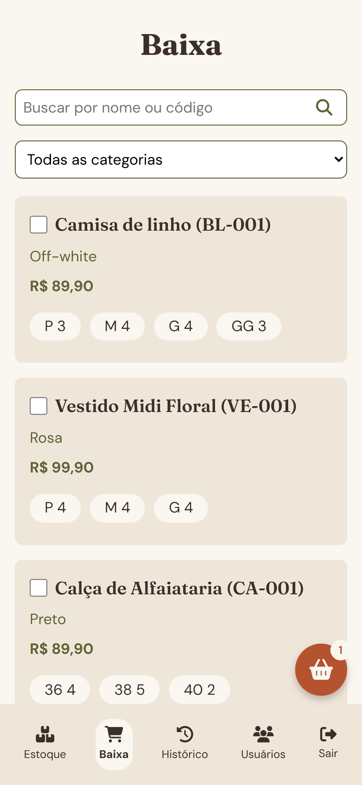
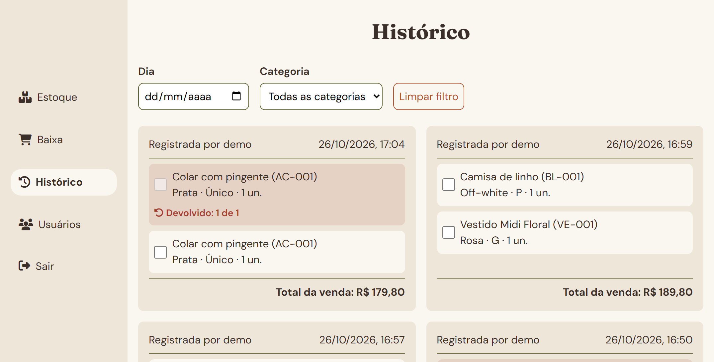
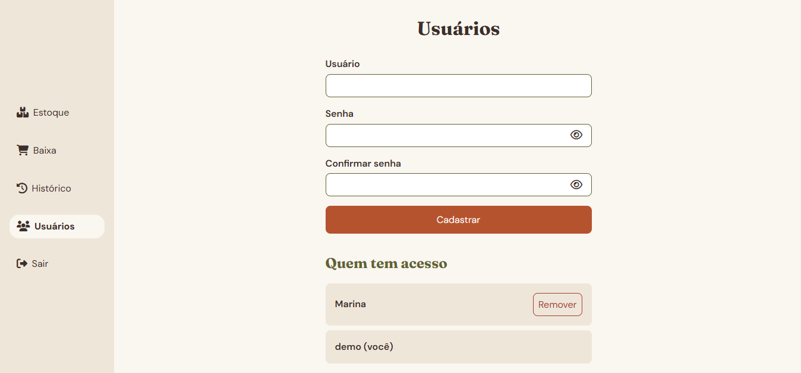

# Fio & Linha 🧵

Fio & Linha é um sistema de controle de estoque para uma loja fictícia de roupa feminina: a equipe cadastra as peças por categoria e tamanho, dá baixa nas vendas em poucos cliques, consulta o histórico de vendas, registra devoluções sem perder o registro da venda original e gerencia quem tem acesso ao sistema.

Pensado e construído como projeto de aprendizado com um backend simples, com foco nos fundamentos: HTML, CSS e JavaScript puro (sem frameworks) no front-end, e Node.js com Express guardando os dados em arquivos JSON. A loja e a cliente ("Marina") são fictícias.

## Demonstração

Este projeto precisa de um servidor Node, então não está publicado no GitHub Pages. Veja [Como rodar localmente](#como-rodar-localmente) para testar no seu computador, ou a seção de [Prints](#prints) abaixo.

## Funcionalidades

### Estoque
- Lista de peças com ícone da categoria, nome, código, etiquetas de tamanho com quantidade e preço
- Alerta de estoque baixo (3 peças ou menos em algum tamanho) que abre uma lista das peças e dos tamanhos que estão acabando, sempre olhando o estoque inteiro, independente da busca e do filtro
- Busca por nome ou código, combinada com o filtro de categoria
- Um modal só para cadastrar e editar peças: a categoria define os tamanhos disponíveis (P/M/G/GG, numeração para calça e tamanho único para acessórios), e o campo de quantidade só aparece para os tamanhos que chegaram
- Modal de detalhes, só para leitura (cor, preço de custo, fornecedor e data de chegada), e modal de confirmação antes de excluir
- Os códigos das peças são únicos, conferidos no servidor, e o formulário mostra uma mensagem quando o código já está em uso

### Baixa (vendas)
- Busca por código ou nome, com filtro de categoria
- Ao selecionar uma peça, um modal pede o tamanho e a quantidade, avisando quando a quantidade passa do estoque
- Resumo do checkout com o número de itens e o total, juntando a mesma peça no mesmo tamanho em uma única linha
- No celular, um botão flutuante mostra quantos itens foram adicionados e leva até o checkout; no desktop, o checkout fica sempre visível ao lado da lista
- O servidor confere todas as linhas antes de mudar qualquer coisa, lê o preço da própria peça (o navegador não consegue alterá-lo), congela o preço do dia na venda, aceita só quantidades inteiras maiores que zero e soma as linhas repetidas antes de conferir o estoque

### Histórico de vendas e devoluções
- Abre mostrando os últimos 7 dias, com filtros por dia e por categoria, e a venda mais recente primeiro
- Cada venda mostra quem registrou, a data e a hora, os produtos e o total
- Devolução de um ou mais produtos, de uma ou várias vendas, por uma barra fixa e um modal em que a quantidade é limitada ao que foi vendido e ainda não voltou
- Cada devolução registra a quantidade, o usuário e a data e a hora, e devolve as peças ao estoque
- Os produtos devolvidos são marcados com cor, texto e ícone (nunca só com cor), com os detalhes de cada devolução ao passar o mouse

### Usuários
- Cadastro de novos usuários com nome, senha e confirmação de senha (mínimo de 6 caracteres), com um botão para mostrar ou ocultar cada senha
- Os nomes de usuário não se repetem (maiúscula e minúscula contam como iguais)
- Remoção de usuários com um modal de confirmação; ninguém consegue remover a si mesma, e remover um usuário também encerra as sessões abertas dele
- As senhas são guardadas como hash (`scrypt` com sal aleatório), nunca em texto puro, e o servidor nunca as devolve

### Login e sessões
- O servidor confere as credenciais e entrega um token, guardado na memória do servidor e no `localStorage` do navegador
- Um middleware protege todas as rotas de dados, e as páginas internas mandam de volta para o login quem não tem um token válido
- Sair também apaga o token no servidor, então um token copiado deixa de funcionar

### Design e acessibilidade
- Mobile-first, com unidades em `rem` e dois pontos de quebra: o menu vira barra lateral em `48rem`, e a lista de peças vira uma linha por peça em `60rem`
- Paleta leve e aconchegante, com Fraunces nos títulos e DM Sans no texto, definidas como variáveis CSS
- Menu montado por JavaScript a partir de uma única lista de itens, destacando a página atual com `aria-current`
- `<dialog>` nativo nos modais (o foco fica dentro, Esc fecha), com nomes acessíveis
- Labels ligadas a todos os campos, mensagens com `role="alert"` e `role="status"` e foco visível no teclado
- Rótulos descritivos nos botões só com ícone (por exemplo, "Remover maria")
- Cor do verde-oliva ajustada para manter pelo menos 4,5:1 de contraste sobre o fundo areia
- Efeitos de hover só em dispositivos que têm hover

## Tecnologias

- HTML5, CSS3 (Flexbox, Grid, media queries, variáveis CSS) e JavaScript puro (`fetch` com `async/await`, manipulação do DOM)
- [Node.js](https://nodejs.org/) com [Express](https://expressjs.com/) 5
- Arquivos JSON (`data/`) lidos e gravados com `fs`
- `crypto` do Node para o hash das senhas (`scrypt`) e os tokens de sessão (`randomUUID`)
- [Font Awesome](https://fontawesome.com/) (ícones)
- [Google Fonts](https://fonts.google.com/) (Fraunces e DM Sans)

## Acesso de demonstração

Na primeira vez, copie o `data/usuarios.exemplo.json` para `data/usuarios.json` (veja os passos abaixo) e entre com:

- **Usuário:** `demo`
- **Senha:** `demo1234`

A senha do arquivo de exemplo está em texto puro de propósito: o servidor a transforma em hash na primeira vez que liga. As peças e as vendas de exemplo em `data/` são fictícias.

Este é um projeto de aprendizado: as sessões ficam na memória do servidor (reiniciar o servidor desconecta todo mundo) e os dados ficam em arquivos JSON, então ele não foi feito para produção.

## Estrutura do projeto

```
server.js                  Servidor Express: rotas da API, sessões e hash das senhas
data/
  pecas.json               Peças de exemplo (estoque)
  vendas.json              Histórico de vendas de exemplo
  usuarios.exemplo.json    Usuário de exemplo para a primeira execução
  usuarios.json            Seus próprios usuários (criado por você, não versionado)
public/
  login.html               Login
  estoque.html             Estoque
  baixa.html               Baixa (vendas)
  historico.html           Histórico de vendas e devoluções
  usuarios.html            Usuários
  css/
    global.css             Variáveis, estilos base, menu, botões e modais
    login.css, estoque.css, baixa.css, historico.css, usuarios.css
  js/
    global.js              Porteiro da sessão, menu e botão Sair
    senha.js               Botões de mostrar e ocultar a senha
    login.js, estoque.js, baixa.js, historico.js, usuarios.js
briefing-fio-e-linha.md    Briefing do projeto (cliente, telas, decisões)
```

## Como rodar localmente

1. Clone o repositório e abra a pasta no terminal.
2. Instale as dependências:
   ```
   npm install
   ```
3. Crie o seu arquivo de usuários a partir do exemplo: copie o `data/usuarios.exemplo.json` e dê à cópia o nome `data/usuarios.json`.
4. Ligue o servidor:
   ```
   npm start
   ```
5. Abra `http://localhost:3000` no navegador e entre com o usuário de demonstração.

## Roadmap

Funcionalidades planejadas, ainda não implementadas:

- Dashboard com receita, lucro, mais vendidos e alertas de estoque, sempre lendo dados que já existem
- Imagens reais dos produtos no lugar dos ícones de categoria
- Na baixa, mostrar quantas peças ainda podem ser adicionadas ("Há apenas 1") em vez do estoque total
- Publicar o sistema em um serviço que roda Node, com o login de demonstração visível na tela de login

## Prints

### Estoque
Lista de peças com o alerta de estoque baixo e as etiquetas de tamanho destacadas.





### Baixa
No desktop, o checkout fica sempre visível ao lado da lista.



No celular, um botão flutuante mostra quantos itens foram adicionados e leva até o checkout.



### Histórico
Vendas com o total e o registro de quem vendeu. O produto devolvido é marcado com cor, texto e ícone.



### Usuários
Cadastro e remoção de quem tem acesso ao sistema.



---

Projeto pessoal de aprendizado, feito por [Nathalia](https://github.com/nathaliadebona). Portfólio: [nathaliadebona.github.io/portfolio](https://nathaliadebona.github.io/portfolio/).
